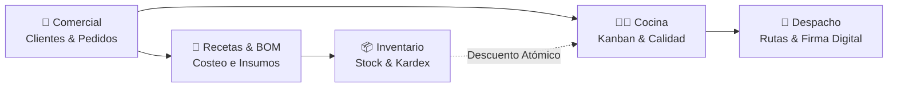
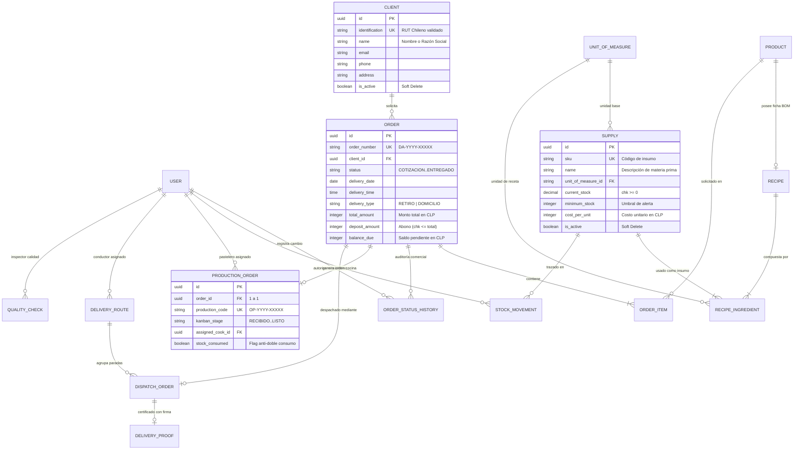

# Dulce Arte — Sistema Integral de Gestión, Producción y Despacho

> **Plataforma Web Integral para Pastelería Artesanal de Alta Gama**  
> Arquitectura monolítica modular desarrollada en **Django 6.1.3**, **Django REST Framework 3.18.3** y **Tailwind CSS**, con soporte para **PostgreSQL** y **SQLite**.

---

## 📌 Tabla de Contenidos
1. [Descripción General](#1-descripción-general)
2. [Stack Tecnológico](#2-stack-tecnológico)
3. [Módulos del Sistema](#3-módulos-del-sistema)
4. [Estructura del Proyecto](#4-estructura-del-proyecto)
5. [Modelo Entidad-Relación (MER)](#5-modelo-entidad-relación-mer)
6. [Instalación y Puesta en Marcha (Local)](#6-instalación-y-puesta-en-marcha-local)
7. [Usuarios y Credenciales de Demostración](#7-usuarios-y-credenciales-de-demostración)
8. [API REST v1](#8-api-rest-v1)
9. [Suite de Pruebas Automatizadas (55 Tests)](#9-suite-de-pruebas-automatizadas-55-tests)
10. [Despliegue en Producción (AWS EC2)](#10-despliegue-en-producción-aws-ec2)

---

## 1. Descripción General

**Dulce Arte** es un sistema web concebido para digitalizar y asegurar la trazabilidad de extremo a extremo en una pastelería artesanal: desde la captación de clientes y cotización de pedidos personalizados, pasando por la explosión de recetas (BOM), el control de existencias en almacén y la preparación en cocina mediante un tablero digital tipo **Kanban**, hasta la logística de reparto con **firma digital táctil** en comprobante de entrega.

### Características Principales:
* **Control Financiero en CLP:** Manejo de precios, costos, abonos y saldos en números enteros nativos (`PositiveIntegerField`), sin fracciones decimales de peso chileno.
* **Trazabilidad Atómica:** Descuento seguro de insumos con bloqueo pesimista de base de datos (`select_for_update`), evitando el doble consumo con la bandera `stock_consumed`.
* **Conversión de Unidades de Medida:** Soporte para unidades de masa (KG, GR), volumen (LT, ML) y conteo (UND) con factores de conversión automáticos y validación de compatibilidad física de recetas.
* **Control de Acceso por Roles (RBAC):** Restricciones operativas independientes para Administradores (`ADMIN`), Asesores (`VENTAS`), Maestros Pasteleros (`COCINA`) y Conductores (`REPARTIDOR`).
* **Diseño Artesanal y Responsivo:** Interfaz moderna estilizada con Tailwind CSS y tipografía editorial (*Playfair Display* e *Inter*), adaptada tanto para computadores como dispositivos móviles.

---

## 2. Stack Tecnológico

| Componente | Tecnología | Versión |
| :--- | :--- | :--- |
| **Backend** | Python | 3.12+ (Compatible con 3.14) |
| **Framework Web** | Django | 6.1.3 |
| **API REST** | Django REST Framework (DRF) | 3.18.3 |
| **Bases de Datos** | PostgreSQL / SQLite | PostgreSQL 16+ (Producción) / SQLite3 (Desarrollo Local) |
| **Driver PostgreSQL** | Psycopg 3 | 3.2.4 |
| **Frontend UI** | Django Templates + Tailwind CSS + JS Vanilla | CDN Tailwind + Canvas API para firmas |
| **Servidor WSGI/Proxy**| Gunicorn + Nginx | Entorno Ubuntu Linux / EC2 |

---

## 3. Módulos del Sistema



1. **Gestión Comercial (`apps/clients` y `apps/orders`):**
   * Directorio de clientes con validación y formateo de RUT chileno.
   * Cotizaciones y pedidos con especificaciones artesanales: bizcocho, relleno, cobertura, dedicatoria personalizada, fecha y hora de entrega.
   * Gestión de abonos anticipados y cálculo automático de saldos pendientes.

2. **Inventario y Existencias (`apps/inventory`):**
   * Catálogo de insumos con alertas de stock crítico (`is_low_stock`).
   * Registro auditable de movimientos de almacén: compras/entradas y mermas con justificación técnica.
   * Historial inmutable tipo Kardex.

3. **Recetas y Ficha Técnica BOM (`apps/recipes`):**
   * Desglose de insumos requeridos por porción o producto.
   * Factores de merma ajustables por ingrediente (0% - 100%).
   * Estimación automática del costo directo de producción en pesos chilenos.

4. **Producción y Tablero Kanban (`apps/production`):**
   * Tablero digital con 5 carriles operativos:
     1. *Recibido en Cocina*
     2. *En Preparación (Masa / Rellenos)* (descuenta automáticamente el stock de insumos)
     3. *Horneado y Decorado*
     4. *Control de Calidad*
     5. *Listo para Despacho*
   * Asignación de pastelero responsable a cada orden.
   * Módulo formal de inspección de calidad antes de entrega.

5. **Logística y Despacho (`apps/dispatch`):**
   * Planificación de hojas de ruta secuenciadas por paradas y conductor asignado.
   * Interfaz de captura de firma digital en canvas para certificación inmediata de entrega a domicilio.

6. **Administración y Usuarios (`apps/users`):**
   * Panel propio de administración de cuentas y perfiles sin exponer la interfaz interna de Django.
   * Asignación de roles y permisos operativos.

---

## 4. Estructura del Proyecto

```text
Dulce-Arte/
├── apps/
│   ├── clients/           # Gestión de clientes, RUT y contactos
│   ├── core/              # Modelos abstractos (TimeStamped, SoftDelete) y validadores
│   ├── dashboard/         # Vistas operativas, formularios web y controladores UI
│   ├── dispatch/          # Hojas de ruta, paradas de despacho y firma digital
│   ├── inventory/         # Insumos, unidades de medida, stock y movimientos Kardex
│   ├── orders/            # Pedidos, cotizaciones, personalizaciones y auditoría
│   ├── production/        # Tablero Kanban, etapas y controles de calidad
│   ├── recipes/           # Catálogo de productos, recetas y explosión BOM
│   └── users/             # Usuario custom con roles RBAC y administración de personal
├── config/
│   ├── settings/
│   │   ├── base.py        # Configuración común y middleware
│   │   ├── local.py       # Configuración para entorno de desarrollo (SQLite / PostgreSQL)
│   │   ├── production.py  # Configuración protegida para AWS / producción
│   │   └── test.py        # Configuración optimizada para ejecución de pruebas
│   ├── urls.py            # Enrutador principal Web y API REST
│   └── wsgi.py            # Entrada WSGI para servidores de producción
├── deploy/                # Scripts de automatización para Ubuntu Linux / AWS EC2
│   ├── nginx-dulce-arte.conf
│   ├── dulce-arte.service
│   └── setup-ec2.sh
├── static/                # Hojas de estilo CSS corporativas y scripts JavaScript
├── templates/             # Plantillas HTML semánticas estilizadas con Tailwind CSS
├── tests/                 # Suite completa de 55 pruebas automatizadas
├── manage.py
├── requirements.txt
├── seed_data.py           # Script para poblar 31 insumos y 7 usuarios con roles
└── seed_orders_clients.py # Script para poblar 10 clientes y 5 órdenes en el Kanban
```

---

## 5. Modelo Entidad-Relación (MER)



---

## 6. Instalación y Puesta en Marcha (Local)

### Requisitos Previos
* **Python 3.12+** instalado.
* **Git** instalado.

### Paso 1: Clonar el Repositorio
```bash
git clone git@github.com:Jose33xdr/Dulce-Arte..git
cd Dulce-Arte
```

### Paso 2: Crear y Activar el Entorno Virtual
* **En Windows (PowerShell):**
  ```powershell
  python -m venv .venv
  .\.venv\Scripts\Activate.ps1
  ```
* **En Linux / macOS:**
  ```bash
  python3 -m venv .venv
  source .venv/bin/activate
  ```

### Paso 3: Instalar Dependencias
```bash
pip install -r requirements.txt
```

### Paso 4: Configurar Variables de Entorno (`.env`)
Copia la plantilla de ejemplo:
* **En Windows:**
  ```powershell
  Copy-Item .env.example .env
  ```
* **En Linux / macOS:**
  ```bash
  cp .env.example .env
  ```

> [!TIP]
> Para desarrollo rápido sin instalar PostgreSQL localmente, el archivo `.env` viene configurado por defecto con `DB_ENGINE=sqlite3`, permitiendo levantar el sistema inmediatamente.

### Paso 5: Ejecutar Migraciones
```bash
python manage.py migrate
```

### Paso 6: Poblar Datos Iniciales de Demostración
Ejecuta los dos scripts de inicialización incluidos:
```bash
# 1. Carga 31 insumos y crea 7 usuarios operativos con roles completos
python seed_data.py

# 2. Carga 10 clientes adicionales y 5 pedidos en las 5 etapas del Kanban
python seed_orders_clients.py
```

### Paso 7: Iniciar el Servidor de Desarrollo
```bash
python manage.py runserver
```
Abre en tu navegador: **[http://127.0.0.1:8000/](http://127.0.0.1:8000/)**

---

## 7. Usuarios y Credenciales de Demostración

Para probar los permisos y accesos por rol (**RBAC**), se encuentran habilitadas las siguientes cuentas de prueba:

> **Contraseña universal para todas las cuentas de prueba:** `admin123`

| Usuario | Nombre Completo | Rol | Accesos Principales |
| :--- | :--- | :--- | :--- |
| **`admin`** | Administrador Dulce Arte | **Administrador (`ADMIN`)** | Acceso total: KPIs, Finanzas, Usuarios, Configuración y eliminación lógica. |
| **`camila.ventas`** | Camila Morales Castro | **Ventas (`VENTAS`)** | Clientes, Cotizaciones, Confirmación de pedidos y Hojas de Ruta. |
| **`matias.ventas`** | Matías Valenzuela Lagos | **Ventas (`VENTAS`)** | Clientes, Registro de pedidos y Programación de entregas. |
| **`sofia.pastelera`** | Sofía Herrera Pinto | **Cocina (`COCINA`)** | Tablero Kanban, Avance de etapas, Registro de mermas y Fichas BOM. |
| **`rodrigo.chef`** | Rodrigo Araya Fuentes | **Cocina (`COCINA`)** | Tablero Kanban, Preparación de masas y Control de calidad. |
| **`valentina.decoradora`** | Valentina Soto Rivas | **Cocina (`COCINA`)** | Tablero Kanban, Decoración y armado de pasteles personalizados. |
| **`diego.repartidor`** | Diego Navarro Bravo | **Repartidor (`REPARTIDOR`)** | Hojas de ruta asignadas y Certificación de entrega con firma digital. |
| **`felipe.despacho`** | Felipe Castillo Toledo | **Repartidor (`REPARTIDOR`)** | Visualización de paradas y Registro de comprobantes de entrega. |

---

## 8. API REST v1

La API REST expone recursos bajo el prefijo `/api/v1/`, protegidos mediante autenticación por sesión y control de permisos por rol:

| Método | Endpoint | Rol Mínimo | Descripción |
| :--- | :--- | :--- | :--- |
| `POST` | `/api/v1/auth/login/` | Público | Autenticación y obtención de sesión activa. |
| `GET`, `POST` | `/api/v1/clients/` | `VENTAS` | Listado paginado y creación de clientes con validación de RUT. |
| `GET`, `POST` | `/api/v1/orders/` | `VENTAS` | Creación de cotizaciones y pedidos con inserción masiva (`bulk_create`). |
| `POST` | `/api/v1/orders/{id}/confirm/` | `VENTAS` | Confirmación formal de pedido con abono y emisión a cocina. |
| `POST` | `/api/v1/orders/{id}/cancel/` | `VENTAS` | Cancelación de pedido con registro en bitácora histórica. |
| `GET` | `/api/v1/orders/{id}/bom_check/` | `COCINA` | Verificación de disponibilidad de existencias para los ítems del pedido. |
| `GET` | `/api/v1/recipes/products/` | Autenticado | Catálogo de productos (filtra automáticamente soft deletes). |
| `GET` | `/api/v1/recipes/products/{id}/bom/`| Autenticado | Explosión técnica de ingredientes y costeo estimado en CLP. |
| `POST` | `/api/v1/inventory/movements/entry/`| `COCINA` | Registro de compras o recepciones de existencias al inventario. |
| `POST` | `/api/v1/inventory/movements/waste/`| `COCINA` | Registro de mermas o desperdicios justificados. |
| `POST` | `/api/v1/production/{id}/transition/`| `COCINA` | Avance de etapa en el tablero Kanban y descuento atómico de stock. |
| `POST` | `/api/v1/production/{id}/quality_check/`| `COCINA` | Registro de aprobación o rechazo de control de calidad. |
| `POST` | `/api/v1/dispatch/{id}/confirm_delivery/`| `REPARTIDOR` | Certificación de entrega con captura de firma digital en base64. |

---

## 9. Suite de Pruebas Automatizadas (55 Tests)

El proyecto cuenta con **55 pruebas unitarias e integrales** que garantizan la solidez del sistema.

Para ejecutar la suite completa de pruebas:
```bash
python manage.py test tests --settings=config.settings.test
```

### Cobertura de la Suite:
* **Integridad de Modelos y SQL:** Restricciones de no negatividad (`CheckConstraint`), no duplicidad de RUTs, integridad referencial protegida (`ProtectedError`) y validación de magnitudes compatibles en recetas.
* **Lógica Financiera:** Validación de abonos no superiores al total (`deposit_amount <= total_amount`) y cálculo de balances en enteros CLP.
* **Transacciones de Inventario:** Descuento atómico de insumos con prevención estricta contra doble consumo (`StockAlreadyConsumedException`).
* **Seguridad y Permisos:** Restricción de acceso a vistas protegidas y validación de endpoints DRF por rol de usuario.
* **Pruebas de Despacho:** Vinculación de hojas de ruta, paradas secuenciales y comprobantes de recepción con firma.

---

## 10. Despliegue en Producción (AWS EC2)

El directorio `deploy/` contiene la automatización para desplegar el proyecto en una instancia **Ubuntu Linux 24.04 LTS / 22.04 LTS** en **AWS EC2**:

### Archivos de Despliegue:
* **`deploy/setup-ec2.sh`**: Script bash que instala PostgreSQL, Gunicorn, Nginx, crea el entorno virtual, aplica migraciones y recopila archivos estáticos.
* **`deploy/nginx-dulce-arte.conf`**: Configuración de servidor Nginx como proxy inverso y servidor de archivos estáticos.
* **`deploy/dulce-arte.service`**: Demonio `systemd` para gestión y reinicio automático del proceso Gunicorn.

### Despliegue con un solo comando:
En la instancia EC2 remota (con el código clonado en `/opt/dulce-arte`):
```bash
sudo bash /opt/dulce-arte/deploy/setup-ec2.sh <IP_PUBLICA_EC2>
```

---

<p align="center">
  <b>Dulce Arte</b> — Pasión y Precisión en Cada Detalle Pastelero.
</p>
